# RideLink — Firebase Firestore Database Architecture & Schema Design

This document details the complete production-grade Firebase Firestore database schema for the **RideLink** carpooling and ride-sharing application. It maps directly to every screen, feature, and workflow in the Figma design and Flutter app.

---

## 1. High-Level Entity Relationship Diagram (ERD)

```mermaid
erDiagram
    USERS ||--o{ RIDES : "publishes (as driver)"
    USERS ||--o{ BOOKINGS : "reserves (as passenger)"
    USERS ||--o{ REVIEWS : "writes / receives"
    USERS ||--o{ NOTIFICATIONS : "receives"
    USERS ||--o{ CHATS : "participates in"
    USERS ||--o{ COMMUNITIES : "joins / manages"
    RIDES ||--o{ BOOKINGS : "contains"
    RIDES ||--o{ CHATS : "linked to"
    RIDES ||--o{ REVIEWS : "associated with"
    BOOKINGS ||--o{ TRANSACTIONS : "generates"
    COMMUNITIES ||--o{ RIDES : "hosts regular"

    USERS {
        string id PK
        string fullName
        string email
        string phoneNumber
        string activeRole
        double rating
        map vehicle
    }

    RIDES {
        string id PK
        string driverId FK
        geopoint origin
        geopoint destination
        timestamp departureTime
        int availableSeats
        double pricePerSeat
        string status
    }

    BOOKINGS {
        string id PK
        string rideId FK
        string passengerId FK
        string driverId FK
        int seatsBooked
        double totalAmount
        string status
    }

    CHATS {
        string id PK
        string rideId FK
        array participants
        string lastMessage
    }

    COMMUNITIES {
        string id PK
        string name
        int memberCount
        int dailyRides
    }
```



---

## 2. Core Firestore Collections Overview

| Collection Path | Purpose | Primary Access Patterns |
| :--- | :--- | :--- |
| `users/{userId}` | User profile, role preferences, saved locations | Profile view, role switcher, emergency contacts |
| `driver_verifications/{userId}` | Driver license, insurance, registration docs | Admin approval, driver onboarding status |
| `rides/{rideId}` | Driver-published scheduled and active trips | Search rides, Home page feed, route tracking |
| `bookings/{bookingId}` | Seat reservations by passengers | Passenger "My Rides", Driver "Requests", fare checkout |
| `chats/{chatId}` | Messaging thread between driver & passenger | In-app messaging sheet |
| `chats/{chatId}/messages/{messageId}` | Individual chat messages | Live real-time chat sync |
| `communities/{communityId}` | Commuting groups (Campus, Workplace, Regional) | Community feed, group membership |
| `reviews/{reviewId}` | 5-star ratings, feedback tags, comments | Driver & passenger trust score calculation |
| `notifications/{notificationId}` | Push & in-app event notifications | In-app notification center |
| `transactions/{transactionId}` | Fare payments, driver payouts, earnings logs | Driver earnings dashboard, passenger receipts |
| `safety_alerts/{alertId}` | SOS emergency triggers, route deviations | Safety Center, emergency contact dispatch |

---

## 3. Detailed Collection Schemas

---

### 3.1 `users` Collection
Stores both passenger and driver account data. When a user switches roles in Settings, `activeRole` is toggled.

**Document Path:** `/users/{userId}`  
*(Note: `userId` matches Firebase Auth `uid`)*

```json
{
  "id": "usr_98a7sd8f97a8sdf",
  "fullName": "Alex Morgan",
  "email": "alex.morgan@email.com",
  "phoneNumber": "+61 400 123 456",
  "photoUrl": "https://storage.googleapis.com/.../avatar.jpg",
  "activeRole": "passenger", // "passenger" | "driver"
  "roles": ["passenger", "driver"], // Roles user is eligible for
  "isEmailVerified": true,
  "passengerStats": {
    "rating": 4.95,
    "ratingCount": 28,
    "tripsCompleted": 28
  },
  "driverStats": {
    "isVerifiedDriver": true,
    "rating": 4.90,
    "ratingCount": 142,
    "tripsCompleted": 142,
    "acceptanceRate": 0.98,
    "isOnline": true
  },
  "vehicle": {
    "make": "Toyota",
    "model": "Camry Hybrid",
    "year": 2022,
    "color": "White",
    "licensePlate": "VIC • 1AB-2CD",
    "totalSeats": 4
  },
  "savedLocations": [
    {
      "id": "loc_1",
      "label": "Home",
      "address": "120 Flinders St, Melbourne VIC 3000",
      "location": {
        "_lat": -37.8175,
        "_long": 144.9671
      }
    },
    {
      "id": "loc_2",
      "label": "Campus",
      "address": "Monash University, Wellington Rd, Clayton VIC 3800",
      "location": {
        "_lat": -37.9105,
        "_long": 145.1362
      }
    }
  ],
  "emergencyContacts": [
    {
      "name": "Sarah Morgan",
      "relationship": "Sister",
      "phone": "+61 411 222 333"
    }
  ],
  "fcmTokens": ["fcm_token_device_abc123"],
  "createdAt": "2026-10-01T10:00:00Z", // Firestore Timestamp
  "updatedAt": "2026-10-05T14:30:00Z"
}
```

---

### 3.2 `driver_verifications` Collection
Maintains sensitive driver document images and verification audit status. Kept in a dedicated collection to apply strict security rules (only accessible by the driver and back-office admins).

**Document Path:** `/driver_verifications/{userId}`

```json
{
  "userId": "usr_98a7sd8f97a8sdf",
  "status": "approved", // "pending" | "approved" | "rejected" | "action_required"
  "rejectionReason": null,
  "documents": {
    "drivingLicense": {
      "frontUrl": "https://storage.googleapis.com/.../dl_front.jpg",
      "backUrl": "https://storage.googleapis.com/.../dl_back.jpg",
      "licenseNumber": "98765432",
      "expiryDate": "2028-12-31",
      "verifiedAt": "2026-10-03T12:00:00Z",
      "status": "verified"
    },
    "vehicleRegistration": {
      "documentUrl": "https://storage.googleapis.com/.../reg_doc.pdf",
      "expiryDate": "2027-06-30",
      "verifiedAt": "2026-10-03T12:00:00Z",
      "status": "verified"
    },
    "vehicleInsurance": {
      "policyNumber": "AAMI-889922",
      "documentUrl": "https://storage.googleapis.com/.../insurance.pdf",
      "expiryDate": "2027-08-15",
      "verifiedAt": "2026-10-03T12:00:00Z",
      "status": "verified"
    },
    "policeCheck": {
      "documentUrl": "https://storage.googleapis.com/.../police_check.pdf",
      "status": "verified",
      "optional": true
    }
  },
  "submittedAt": "2026-10-02T16:00:00Z",
  "reviewedAt": "2026-10-03T12:00:00Z",
  "reviewerAdminId": "admin_001"
}
```

---

### 3.3 `rides` Collection
The central operational collection. Created when a driver publishes a ride. Searched by passengers using geohash and departure time.

**Document Path:** `/rides/{rideId}`

```json
{
  "id": "ride_mel_clayton_001",
  "driverId": "usr_98a7sd8f97a8sdf",
  "driver": {
    "name": "James Miller",
    "photoUrl": "https://storage.googleapis.com/.../driver.jpg",
    "rating": 4.9,
    "totalRides": 142,
    "phone": "+61 400 999 888",
    "isVerified": true
  },
  "vehicle": {
    "model": "Toyota Camry Hybrid",
    "color": "White",
    "plate": "VIC • 1AB-2CD"
  },
  "origin": {
    "name": "Flinders St Station",
    "address": "Flinders St, Melbourne VIC 3000",
    "geopoint": {
      "_lat": -37.8180,
      "_long": 144.9671
    },
    "geohash": "r1r0g2"
  },
  "destination": {
    "name": "Monash University, Clayton",
    "address": "Clayton Campus, Wellington Rd, Clayton VIC 3800",
    "geopoint": {
      "_lat": -37.9105,
      "_long": 145.1362
    },
    "geohash": "r1r0vg"
  },
  "stops": [
    {
      "name": "Richmond Station",
      "order": 1,
      "geopoint": { "_lat": -37.8240, "_long": 144.9980 }
    },
    {
      "name": "Oakleigh Station",
      "order": 2,
      "geopoint": { "_lat": -37.9000, "_long": 145.0880 }
    }
  ],
  "routePolyline": "n~x_FfsyzL...", // Encoded Google Maps polyline
  "departureTime": "2026-10-06T08:30:00Z", // Firestore Timestamp
  "estimatedDurationMinutes": 35,
  "totalSeats": 3,
  "availableSeats": 2, // Decremented atomically upon booking confirmation
  "bookedSeatsCount": 1,
  "pricePerSeat": 12.00,
  "currency": "AUD",
  "preferences": {
    "allowLuggage": true,
    "allowPets": false,
    "allowSmoking": false,
    "airConditioned": true
  },
  "communityId": "comm_monash_01", // Optional: linked to a commuter group
  "status": "scheduled", // "scheduled" | "active" | "completed" | "cancelled"
  "liveTracking": {
    "currentLocation": {
      "_lat": -37.8200,
      "_long": 144.9750
    },
    "speedKmH": 60,
    "headingDegrees": 115.0,
    "etaMinutes": 8,
    "lastUpdatedAt": "2026-10-06T08:15:20Z"
  },
  "createdAt": "2026-10-05T18:00:00Z",
  "updatedAt": "2026-10-06T08:15:20Z"
}
```

---

### 3.4 `bookings` Collection
Represents a passenger's reservation of seats in a published ride.

**Document Path:** `/bookings/{bookingId}`

```json
{
  "id": "book_99238492",
  "rideId": "ride_mel_clayton_001",
  "passengerId": "usr_passenger_alex",
  "driverId": "usr_98a7sd8f97a8sdf",
  "passenger": {
    "name": "Alex Morgan",
    "photoUrl": "https://storage.googleapis.com/.../alex.jpg",
    "rating": 4.95,
    "phone": "+61 400 123 456"
  },
  "rideSnapshot": {
    "originName": "Flinders St Station",
    "destinationName": "Monash University, Clayton",
    "departureTime": "2026-10-06T08:30:00Z",
    "driverName": "James Miller",
    "carModel": "Toyota Camry Hybrid • White",
    "carPlate": "VIC • 1AB-2CD"
  },
  "pickupPoint": {
    "name": "Main Entrance Clock",
    "address": "Flinders St, Melbourne",
    "geopoint": { "_lat": -37.8180, "_long": 144.9671 }
  },
  "seatsBooked": 1,
  "pricePerSeat": 12.00,
  "totalAmount": 12.00,
  "serviceFee": 1.50,
  "paymentStatus": "held_in_escrow", // "pending" | "held_in_escrow" | "released_to_driver" | "refunded"
  "status": "confirmed", // "pending" | "confirmed" | "declined" | "in_progress" | "completed" | "cancelled"
  "cancellation": {
    "cancelledBy": null,
    "reason": null,
    "cancelledAt": null
  },
  "createdAt": "2026-10-05T20:30:00Z",
  "updatedAt": "2026-10-06T08:00:00Z"
}
```

---

### 3.5 `chats` & `messages` Subcollection
Powers in-app real-time messaging between passenger and driver for an active ride.

**Chat Document Path:** `/chats/{chatId}`

```json
{
  "id": "chat_ride_mel_clayton_001_alex",
  "rideId": "ride_mel_clayton_001",
  "bookingId": "book_99238492",
  "participants": ["usr_98a7sd8f97a8sdf", "usr_passenger_alex"],
  "participantInfo": {
    "usr_98a7sd8f97a8sdf": {
      "name": "James Miller",
      "role": "driver",
      "avatar": "https://storage.googleapis.com/.../james.jpg"
    },
    "usr_passenger_alex": {
      "name": "Alex Morgan",
      "role": "passenger",
      "avatar": "https://storage.googleapis.com/.../alex.jpg"
    }
  },
  "lastMessage": "Look for the white Toyota Camry with hazard lights.",
  "lastMessageSenderId": "usr_98a7sd8f97a8sdf",
  "lastMessageTimestamp": "2026-10-06T08:18:00Z",
  "unreadCounts": {
    "usr_98a7sd8f97a8sdf": 0,
    "usr_passenger_alex": 1
  },
  "createdAt": "2026-10-06T08:14:00Z"
}
```

**Message Document Path:** `/chats/{chatId}/messages/{messageId}`

```json
{
  "id": "msg_001",
  "senderId": "usr_98a7sd8f97a8sdf",
  "senderName": "James Miller",
  "text": "Hi Alex! I am currently heading towards Flinders St station.",
  "type": "text", // "text" | "location_share" | "image"
  "isRead": true,
  "createdAt": "2026-10-06T08:15:00Z"
}
```

---

### 3.6 `communities` Collection
Powers regional, campus, and corporate commuter networks.

**Document Path:** `/communities/{communityId}`

```json
{
  "id": "comm_monash_01",
  "name": "Monash University Clayton Carpool",
  "description": "Daily rides between Clayton campus and Eastern suburbs.",
  "category": "university", // "university" | "corporate" | "regional" | "metro"
  "iconName": "school_outlined",
  "coverImageUrl": "https://storage.googleapis.com/.../monash_banner.jpg",
  "memberCount": 480,
  "dailyRides": 24,
  "adminUserIds": ["usr_admin_clayton"],
  "primaryLocation": {
    "name": "Monash Clayton Campus",
    "geopoint": { "_lat": -37.9105, "_long": 145.1362 }
  },
  "isPublic": true,
  "createdAt": "2026-09-01T00:00:00Z"
}
```

**Subcollection:** `/communities/{communityId}/members/{userId}`

```json
{
  "userId": "usr_passenger_alex",
  "role": "member", // "member" | "moderator" | "admin"
  "joinedAt": "2026-10-04T11:20:00Z"
}
```

---

### 3.7 `reviews` Collection
Stores bidirectional feedback submitted after ride completion.

**Document Path:** `/reviews/{reviewId}`

```json
{
  "id": "rev_778899",
  "rideId": "ride_mel_clayton_001",
  "bookingId": "book_99238492",
  "reviewerId": "usr_passenger_alex",
  "reviewerName": "Alex Morgan",
  "reviewerRole": "passenger",
  "targetUserId": "usr_98a7sd8f97a8sdf", // Driver being rated
  "targetUserRole": "driver",
  "rating": 5.0,
  "tags": ["Polite", "Clean Car", "Smooth Drive", "On Time"],
  "comment": "Great trip with James! The car was super clean and we arrived right on time for my lecture.",
  "createdAt": "2026-10-06T09:20:00Z"
}
```

---

### 3.8 `transactions` Collection
Tracks monetary flows, earnings, platform commissions, and payout ledger entries.

**Document Path:** `/transactions/{transactionId}`

```json
{
  "id": "tx_20261006_001",
  "bookingId": "book_99238492",
  "rideId": "ride_mel_clayton_001",
  "payerUserId": "usr_passenger_alex",
  "payeeUserId": "usr_98a7sd8f97a8sdf",
  "grossAmount": 12.00,
  "platformFee": 1.50,
  "netDriverAmount": 10.50,
  "currency": "AUD",
  "paymentMethod": "apple_pay",
  "stripePaymentIntentId": "pi_3N9x2390sdfjsdf9",
  "status": "succeeded", // "pending" | "succeeded" | "transferred" | "refunded"
  "payoutStatus": "scheduled", // "scheduled" | "paid_out"
  "createdAt": "2026-10-06T08:30:00Z"
}
```

---

### 3.9 `safety_alerts` Collection
Used by the Safety Center & SOS trigger.

**Document Path:** `/safety_alerts/{alertId}`

```json
{
  "id": "alert_20261006_911",
  "rideId": "ride_mel_clayton_001",
  "userId": "usr_passenger_alex",
  "userRole": "passenger",
  "type": "sos_emergency", // "sos_emergency" | "route_deviation" | "unresponsive"
  "location": {
    "_lat": -37.8210,
    "_long": 144.9780
  },
  "emergencyContactsNotified": true,
  "emergencyServicesDispatched": false,
  "status": "investigating", // "open" | "investigating" | "resolved" | "false_alarm"
  "timestamp": "2026-10-06T08:45:00Z"
}
```

---

## 4. Required Composite Indexes (`firestore.indexes.json`)

To enable smooth queries (such as finding rides departing today, filtered by status and price):

```json
{
  "indexes": [
    {
      "collectionGroup": "rides",
      "queryScope": "COLLECTION",
      "fields": [
        { "fieldPath": "status", "order": "ASCENDING" },
        { "fieldPath": "departureTime", "order": "ASCENDING" }
      ]
    },
    {
      "collectionGroup": "rides",
      "queryScope": "COLLECTION",
      "fields": [
        { "fieldPath": "driverId", "order": "ASCENDING" },
        { "fieldPath": "status", "order": "ASCENDING" },
        { "fieldPath": "departureTime", "order": "ASCENDING" }
      ]
    },
    {
      "collectionGroup": "bookings",
      "queryScope": "COLLECTION",
      "fields": [
        { "fieldPath": "passengerId", "order": "ASCENDING" },
        { "fieldPath": "status", "order": "ASCENDING" },
        { "fieldPath": "createdAt", "order": "DESCENDING" }
      ]
    },
    {
      "collectionGroup": "bookings",
      "queryScope": "COLLECTION",
      "fields": [
        { "fieldPath": "driverId", "order": "ASCENDING" },
        { "fieldPath": "status", "order": "ASCENDING" },
        { "fieldPath": "createdAt", "order": "DESCENDING" }
      ]
    },
    {
      "collectionGroup": "chats",
      "queryScope": "COLLECTION",
      "fields": [
        { "fieldPath": "participants", "arrayConfig": "CONTAINS" },
        { "fieldPath": "lastMessageTimestamp", "order": "DESCENDING" }
      ]
    }
  ]
}
```

---

## 5. Security Rules Blueprint (`firestore.rules`)

```javascript
rules_version = '2';
service cloud.firestore {
  match /databases/{database}/documents {
    
    // Helper functions
    function isAuthenticated() {
      return request.auth != null;
    }
    function isOwner(userId) {
      return isAuthenticated() && request.auth.uid == userId;
    }
    
    // Users Profile
    match /users/{userId} {
      allow read: if isAuthenticated();
      allow write: if isOwner(userId);
    }
    
    // Driver Verifications (Strict: only user can read/write their own docs)
    match /driver_verifications/{userId} {
      allow read, write: if isOwner(userId);
    }
    
    // Rides Collection
    match /rides/{rideId} {
      allow read: if isAuthenticated();
      allow create: if isAuthenticated() && request.resource.data.driverId == request.auth.uid;
      allow update: if isAuthenticated() && (
        resource.data.driverId == request.auth.uid || 
        // Allow decrementing availableSeats during atomic seat booking
        request.resource.data.diff(resource.data).affectedKeys().hasOnly(['availableSeats', 'bookedSeatsCount'])
      );
      allow delete: if isAuthenticated() && resource.data.driverId == request.auth.uid;
    }
    
    // Bookings Collection
    match /bookings/{bookingId} {
      allow read: if isAuthenticated() && (
        resource.data.passengerId == request.auth.uid || 
        resource.data.driverId == request.auth.uid
      );
      allow create: if isAuthenticated() && request.resource.data.passengerId == request.auth.uid;
      allow update: if isAuthenticated() && (
        resource.data.passengerId == request.auth.uid || 
        resource.data.driverId == request.auth.uid
      );
    }
    
    // In-App Chat
    match /chats/{chatId} {
      allow read, write: if isAuthenticated() && request.auth.uid in resource.data.participants;
      
      match /messages/{messageId} {
        allow read, write: if isAuthenticated() && request.auth.uid in get(/databases/$(database)/documents/chats/$(chatId)).data.participants;
      }
    }
    
    // Communities
    match /communities/{communityId} {
      allow read: if isAuthenticated();
      allow write: if isAuthenticated();
      
      match /members/{userId} {
        allow read: if isAuthenticated();
        allow write: if isOwner(userId);
      }
    }
    
    // Reviews
    match /reviews/{reviewId} {
      allow read: if isAuthenticated();
      allow create: if isAuthenticated() && request.resource.data.reviewerId == request.auth.uid;
    }
  }
}
```

---

## 6. Denormalization & Performance Strategy

1. **Driver Avatar & Name Cached in `rides` & `bookings`**:
   - Rather than executing an extra query to `users/{driverId}` for each ride in the list, the driver's name, avatar, and rating are embedded in the `rides` document. This cuts Firestore read operations by **50%**.
2. **Atomic Seat Booking**:
   - When a passenger books a seat, use a Firestore `runTransaction()` to atomically decrement `availableSeats` in the `rides/{rideId}` document and create the `bookings/{bookingId}` record, preventing race-condition double-bookings.
3. **Geohash Queries**:
   - Storing `geohash` on `origin` and `destination` allows nearby ride queries (`geohashQueryBounds`) without requiring an external geospatial database.
